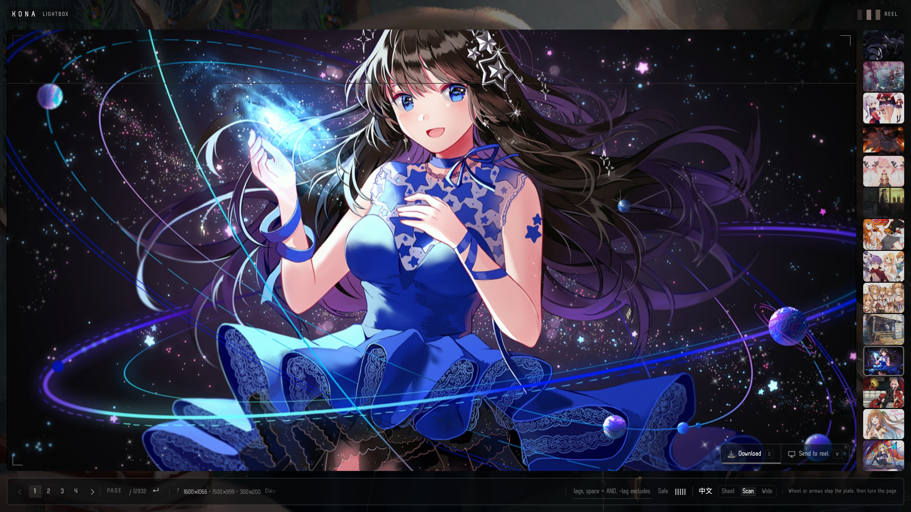

# konachan-leptos

<p align="center">
  
</p>

<p align="center">
  <a href="https://www.rust-lang.org/"></a>
  <a href="https://leptos.dev/"></a>
  <a href="https://github.com/lf-wxp/konachan-leptos"></a>
  <a href="https://github.com/lf-wxp/konachan-leptos/releases"></a>
</p>

<p align="center">
  A modern, fast, and beautiful web frontend for <a href="https://konachan.com/">Konachan</a>, built with Rust and WebAssembly using the <a href="https://leptos.dev/">Leptos</a> framework.
</p>

<p align="center">
  <a href="./README.zh-CN.md">中文文档</a>
</p>

---

## 📖 Overview

**konachan-leptos** is a high-performance single-page application (SPA) that provides an enhanced browsing experience for Konachan image boards. Leveraging the power of Rust and WebAssembly, it delivers lightning-fast performance with a modern UI.

This repository contains the **web frontend only**. The backend API server that supplies image data can be found at [konachan-api](https://github.com/lf-wxp/konachan-api).

---

## ✨ Features

| Feature | Description |
|---------|-------------|
| 🖼️ **Lightbox Stage** | Full-bleed plate with a film-strip rail, three rail densities, and wheel/arrow/swipe navigation |
| 📥 **Download Management** | Built-in download queue with progress tracking |
| 🎨 **Dynamic Wallpaper** | Set images as dynamic wallpapers |
| 🎭 **Safe Mode** | Configurable content filtering for safe browsing |
| 🌓 **Theme Support** | Customizable UI with theme colors |
| 🔍 **Advanced Search** | Powerful tag-based search and filtering |
| ⚡ **Blazing Fast** | Powered by Rust/WASM for near-native performance |
| 📱 **Responsive** | Works seamlessly on desktop and mobile devices |
| 🐳 **Docker Ready** | One-command deployment with Docker |

---

## 🛠️ Technology Stack

- **Framework**: [Leptos 0.8](https://leptos.dev/) - Fine-grained reactive Rust framework for WebAssembly (CSR build)
- **Language**: Rust (Edition 2024)
- **Styling**: Static SCSS compiled by Trunk (no runtime style injection)
- **State Management**: Leptos signals (`RwSignal` / `Memo`) behind a single `AppState` context, with pure reducers for pagination, downloads and toasts
- **WASM Bindings**: 
  - [wasm-bindgen](https://github.com/rustwasm/wasm-bindgen) - High-level interactions between WASM and JavaScript
  - [gloo-net](https://github.com/rustwasm/gloo/tree/master/crates/net) - HTTP client used by the transport layer
- **Build Tool**: [Trunk](https://trunkrs.dev/) - WASM web application bundler (with the bundled Dart Sass)
- **Desktop (Optional)**: [Tauri](https://tauri.app/) - Build smaller, faster, and more secure desktop applications

---

## 🚀 Quick Start

### Prerequisites

- [Rust](https://www.rust-lang.org/) toolchain (1.94+)
- `wasm32-unknown-unknown` target: 
  ```bash
  rustup target add wasm32-unknown-unknown
  ```
- [Trunk](https://trunkrs.dev/): 
  ```bash
  cargo install trunk@0.21.14
  ```
- (Optional) [cargo-make](https://github.com/sagiegurari/cargo-make): 
  ```bash
  cargo install cargo-make
  ```

### Feature Flags

| Flag | Description |
|------|-------------|
| `fake` | Use mock data for development without a backend |
| `safe` | Compile-time default for safe mode (runtime-overridable, see below) |
| `web` | Production web build (calls the same-origin `/api/`) |
| `tauri` | Enable Tauri integration for desktop builds |

### Development

#### Using Trunk directly

```bash
# Dev server with fake data (no backend needed), port 8888
trunk serve --features fake

# Dev server with web feature (requires backend at localhost:8000)
trunk serve --features web

# Dev server with safe mode enabled
trunk serve --features safe
```

#### Using cargo-make (Recommended)

```bash
# Dev with fake data
cargo make dev-fake

# Dev with web feature (requires backend)
cargo make dev-web

# Dev with safe mode
cargo make dev-safe
```

The dev server runs on **port 8888** by default. API requests to `/api/` are proxied to `http://localhost:8000`.

### Available Tasks

```bash
# Format code
cargo make format

# Run clippy lints
cargo make clippy

# Format + clippy check
cargo make check

# Run tests
cargo make test

# Clean build artifacts
cargo make clean
```

---

## 📦 Production Build

### Web Build

```bash
trunk build --release --features web
```

The output static files will be in the `dist/` directory.

### Docker Deployment

#### Build the Docker image

```bash
# Using cargo-make
cargo make docker-build

# Or directly
docker build -t konachan-leptos:latest .
```

#### Run the container

```bash
# Using cargo-make (maps to port 8080)
cargo make docker-run

# Or directly
docker run --rm -p 8080:80 --name konachan-leptos konachan-leptos:latest
```

#### Runtime Configuration (one image, two modes)

The image is built once with the `web` feature. Safe mode (sensitive content is
always filtered and the toggle is hidden) is selected at **container start**
through the `KONACHAN_SAFE` environment variable, so there is no need to build a
separate image per mode:

```bash
# Regular mode (default)
docker run --rm -p 8080:80 -e KONACHAN_SAFE=false konachan-leptos:latest

# Safe mode
docker run --rm -p 8080:80 -e KONACHAN_SAFE=true konachan-leptos:latest
```

On startup the nginx entrypoint regenerates `/config.js`, which the WASM bundle
reads from `window.__KONACHAN_CONFIG__` before rendering. Accepted truthy values
are `true`, `1`, `yes` and `on`; anything else (or unset) means regular mode.
The same mechanism works on any static host - just edit `dist/config.js`.

During local development `/config.js` is an empty object, so the compile-time
`safe` feature (`cargo make dev-safe`) still decides the mode.

#### Docker Architecture

The Dockerfile uses a **multi-stage build**:

1. **Builder stage** (`rust:1.94-trixie`): Compiles Rust/WASM with Trunk
2. **Runner stage** (`nginx:1.27-bookworm`): Serves static files with nginx

The nginx configuration includes:
- Gzip compression for WASM, JS, CSS, and SVG
- Aggressive caching for static assets (1 year, immutable)
- SPA fallback (all routes serve `index.html`)
- A never-cached `/config.js` for the runtime configuration

#### API Routing

The image serves static files only and does **not** proxy `/api/` requests. The
frontend calls `/api/*` on its own origin, so the surrounding deployment is
responsible for routing those calls to the backend - use an upstream reverse
proxy, an ingress rule or a gateway:

```nginx
location /api/ {
    proxy_pass http://backend:8000/;
    proxy_set_header Host $host;
    proxy_set_header X-Real-IP $remote_addr;
    proxy_set_header X-Forwarded-For $proxy_add_x_forwarded_for;
    proxy_set_header X-Forwarded-Proto $scheme;
}
```

#### Stop the container

```bash
# Using cargo-make
cargo make docker-stop

# Or directly
docker stop konachan-leptos
```

---

## 📁 Project Structure

```
konachan-leptos/
├── src/
│   ├── components/     # Leptos components (Nav, List, Search, Notify, …)
│   ├── state/          # Reactive store (AppState) + pure reducers (page/downloads/notices)
│   ├── utils/          # Browser helpers, waterfall layout, canvas animations
│   ├── api.rs          # Transport layer (HTTP or Tauri)
│   ├── model.rs        # Data models and structs
│   ├── app.rs          # Root component (providers + layout)
│   └── main.rs         # Application entry point
├── static/             # Static assets
│   ├── css/            # Stylesheets (style.scss + _components.scss)
│   ├── font/           # Font files
│   ├── image/          # Image assets
│   ├── mock/           # Mock data for development
│   └── script/         # JavaScript utilities (incl. runtime config.js)
├── docker/             # Container entrypoint hooks
├── dist/               # Build output (production)
├── Cargo.toml          # Rust dependencies
├── Trunk.toml          # Trunk configuration
├── Dockerfile          # Docker multi-stage build
└── Makefile.toml       # cargo-make tasks
```

---

## 🤝 Contributing

Contributions are welcome! Please feel free to submit a Pull Request. For major changes, please open an issue first to discuss what you would like to change.

### Contributing Steps

1. Fork the repository
2. Create your feature branch (`git checkout -b feature/AmazingFeature`)
3. Commit your changes (`git commit -m 'Add some AmazingFeature'`)
4. Push to the branch (`git push origin feature/AmazingFeature`)
5. Open a Pull Request

### Code Style

This project follows:
- [Rust Style Guide](https://doc.rust-lang.org/1.0.0/style/README.html)
- [Airbnb CSS Style Guide](https://github.com/airbnb/css)
- All code is formatted with `rustfmt` and linted with `clippy`

---

## 📝 License

This project is licensed under the MIT License - see the [LICENSE](LICENSE) file for details.

---

## 🔗 Related Projects

| Project | Description |
|---------|-------------|
| [konachan-api](https://github.com/lf-wxp/konachan-api) | Backend API server for Konachan image data |
| [konachan-tauri](https://github.com/lf-wxp/konachan-tauri) | Desktop application version using Tauri framework |

---

## 🙏 Acknowledgments

- [Konachan](https://konachan.com/) for providing the image board API
- [Leptos](https://leptos.dev/) team for the amazing Rust/WASM framework
- All contributors who have helped with this project

---

## 📧 Contact

- GitHub Issues: [Report a bug or request a feature](https://github.com/lf-wxp/konachan-leptos/issues)
- Project Link: [https://github.com/lf-wxp/konachan-leptos](https://github.com/lf-wxp/konachan-leptos)

---

<p align="center">
  Made with ❤️ using Rust + WebAssembly
</p>
